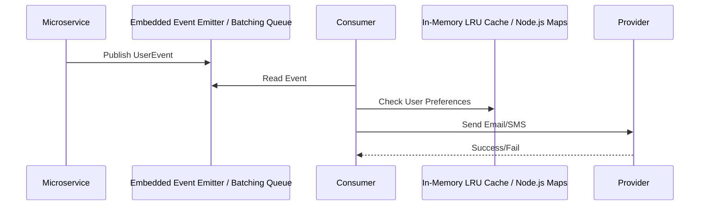
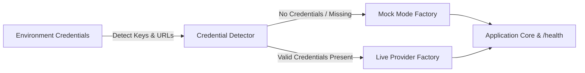

# event-driven-notifications Architecture
> Maturity: Functional Prototype

## System Diagram
The following Mermaid.js sequence diagram maps the core workflow and interactions within the system:

## Component Breakdown
- **Core Technology**: Node.js, Embedded Event Emitter / Batching Queue, In-Memory LRU Cache / Node.js Maps
- **Design Paradigm**: Emphasizes high availability, fault tolerance, and security boundaries.

## Security & Scaling Considerations
- Strict input validations and sanitization.
- Horizontal scalability achieved via stateless workers and queues where applicable.
- Encrypted data at rest and in transit.

## Progressive Credential Loading & Production Architecture (v0.2.0)

This service implements the **Progressive Credential Loading (PCL)** pattern, decoupling development speed from external infrastructure provisioning:

### Core Architecture Components
1. **Mode Detection Singleton:** Inspects environment configuration at boot time without hard crashes on missing secrets.
2. **Dual-Mode Factory Wrappers:**
   - **Storage / Cache:** In-process maps or SQLite `:memory:` transparently promote to managed Redis or PostgreSQL when connection strings are supplied.
   - **AI Providers:** Deterministic heuristic generators and local embeddings transparently promote to live OpenAI, Anthropic, or Gemini API clients.
3. **Hot-Reload & Dynamic TLS:** File watchers monitor mounted volume paths (Kubernetes ConfigMaps and Secrets) to update certificates and limit configs atomically without process restarts.
4. **Health & Observability:** The `/health` endpoint exposes real-time runtime mode metadata (`mock` vs `live`) across all backing adapters.
